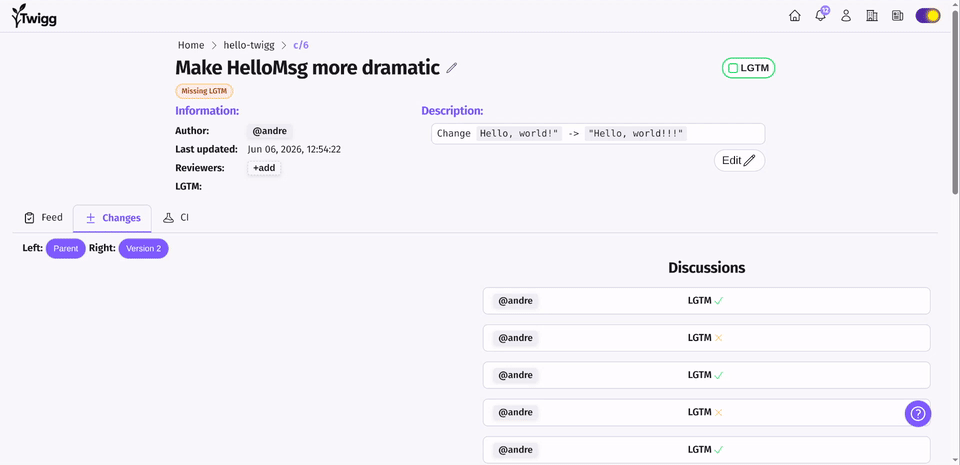

  <picture>
    <source media="(prefers-color-scheme: dark)" srcset="twigg-web/handlers/landing/files/logo.png">
    
  </picture>

  
  
  
  
  
  

# What is it?

Twigg is a **Free & Open Source Centralized Version Control and Development Platform**.

  

## Why Twigg

Twigg was born out of a belief that the version control most of the industry uses is inefficient. Git was made for distributed development: no authoritative server, patches sent over email, every clone carrying the full history. Most teams work in **one centralized codebase** instead, and pay for that flexibility in complexity.

Big tech's internal tooling is centralized, **far more efficient and much simpler to use**. Twigg brings that to everyone, built on how we believe software should be developed:

- **Trunk-based development**, not long-lived branches
- **Small increments**, each one reviewed and tested on its own
- A **monorepo**, with clear ownership of every directory

It's written from scratch, combining the best ideas from other version control systems:

- Mercurial: delta compression and commit obsolescence
- Git: Merkle trees
- Fossil: a single binary with integrated tools
- Google's Critique and Meta's Phabricator: stacked code review and stable commit ids like `c/123`

## Features

- **Version control**: stacked commits with versions. Amend any commit and everything on top of it is rebased. No branches, no staging area.
- **Git mirror**: Twigg works on top of your existing Git repository: every submitted commit is pushed to it, so deploys, CI and anything else that reads from Git keep working. Adopt Twigg gradually, or leave anytime.
- **Code review**: every commit is reviewed on its own, version by version, with OWNERS files declaring who owns each directory.
- **CI/CD**: `CI.json` and `CD.json` jobs live in the repo next to the code they test and only run when their folder changes. Unlimited minutes.
- **Issue tracker**: bugs and feature requests live next to the code, linked to the commits that fix them.
- **API for agents**: the CLI is backed by the server's API, so agents can do what you do: read bugs (`tw bug-get`), set review descriptions, etc. `tw skill` teaches them how, and more of the API is on the way.

Full documentation: [twigg.vc/docs](https://twigg.vc/docs/v/2/)

# Why is this on GitHub?
Naturally, we eat our own dogfood: Twigg is developed using Twigg.
The actual development happens on our hosted instance at
[twigg.vc/twigg/monorepo](https://twigg.vc/twigg/monorepo), a public repository
where you can see Twigg being used live.

GitHub is kept as a read-only mirror.

# What's in this repo?
Basically everything but "secrets" (i.e. passwords).
If you look around, you'll see this repository contains not only all the source code but even the runbooks we use to deploy our services. This is intentional. We can't rely on security through obscurity, and we believe radical transparency is essential to the success of this project.

# Getting started

We host Twigg under [twigg.vc](https://twigg.vc) with free and paid plans so you can easily try it out without having to self-host.

It offers [Git Mirror](https://twigg.vc/docs/v/2/git-mirror/) functionality: all submitted commits are pushed to a Git repository. This allows you to test it out but easily switch back to a Git server if needed.

See a tutorial [here](https://twigg.vc/docs/v/2/category/getting-started).

Twigg also ships a [VS Code extension](https://marketplace.visualstudio.com/items?itemName=Twigg.twigg) and Twigg Links, a browser extension for [Chrome](https://chromewebstore.google.com/detail/fdbalodlehkpnmaocfhhjfdbhhbeoelg) and [Firefox](https://addons.mozilla.org/firefox/addon/twigg-links/) that opens `go/<alias>`, `b/1234` and `c/1234` typed in the address bar in your repository ([docs](https://twigg.vc/docs/v/2/twigg-links/)).

# FAQ

## Why is it called Twigg?
A twig is a short branch - which is what Twigg wants your branches to be.

## Is it production ready?
Yes. Twigg has been used in production for more than a year not only for Twigg's own development but also by 3 partner companies.

That said, when compared to projects such as Git, Twigg is relatively new; so backups (which you can easily enable with the [Git Mirror](https://twigg.vc/docs/v/2/git-mirror/) functionality) are recommended.

# Running and building locally

All the build scripts use the Twigg CLI to tag the build commit number.
Thus, you must install the CLI before running any build script.

- Requirements: **go**
- `cd tw && go install`

To check the installation, run `tw version`.

## Running locally

Note: both servers only run on Linux.

**twigg-web** is the "main" web server you see in [twigg.vc](https://twigg.vc). It hosts repositories, the documentation, the CLI binaries and everything else. To run it locally:
- Requirements: **tw CLI**, **go**, **node** and [task](https://taskfile.dev/)
- `cd twigg-web && task setup && task run`

**twigg-track** is the server "in which the runners run" (hence the name *Track*), i.e. the server that runs CI/CD jobs. To run it locally:
- Requirements: **tw CLI**, **go**, **docker** (required for running jobs in containers) and **LXD** (required for running jobs in VMs)
- `cd twigg-track && task run`
- Tip: `task mock` runs it with a mocked runner instead - no docker or LXD required.

If both servers are running locally, twigg-web will post jobs to twigg-track.

You can then install the CLI following the local instance's docs.
The only caveat is: cloning a repo won't work because you must change the server's URL (which is set to `https://twigg.vc` by default for safety). To clone an example repository you should instead run:
`mkdir BookOne && cd BookOne && tw init && tw enable-unsafe-dev-mode true && tw unsafe-server http://localhost:9001/aang/BookOne`.
Then, generate a key in `http://localhost:9001/user-settings` and run `tw key <key copied from the browser>`. Running `tw pull` and `tw push` should now work.

## Building from source

Ensure you have all the required dependencies:
- **tw CLI** is required for any `task` build script
- **go** is required for any build
- [task](https://taskfile.dev/) and **make** are used for build scripts
- **docker** and **LXD** are required for running jobs in the CI/CD server
- **node** is used to build the VSCode extension and the *web components* used by twigg-web

Build commands:
- `cd twigg-web && task setup && task build`: download node deps and build the web server. Note that this also builds the CLI for all platforms and embeds them into the binary.
- `cd twigg-track && task build`: build the CI/CD server.
- `cd twigg-vscode && make setup && make install`: install the VSCode extension.

To run all tests: `make test-all` from repo root

# License

This project is licensed under the GNU Affero General Public License v3.0 (AGPL-3.0).

**Notice:** Unless otherwise noted, all files in this repository are covered by this license.

See `LICENSE.txt` for the full license text.